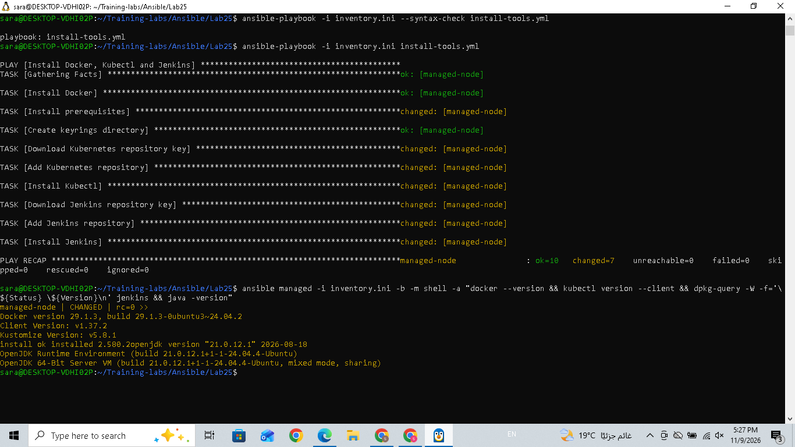

# Lab 25: Automated Web Server Configuration Using Ansible Playbooks

## Objective

Automate the installation of the following tools on a Managed Node using Ansible Playbooks:

- Docker
- Kubectl
- Jenkins

---

## Step 1: Create Lab Directory

Navigate to the Ansible directory and create Lab25:

```bash
cd ~/Training-labs/Ansible
mkdir -p Lab25
cd Lab25
```

Copy the inventory file from Lab24:

```bash
cp ../Lab24/inventory.ini .
```

## Step 2: Configure Inventory

Create the inventory file containing the Managed Node connection details.

```bash
cat inventory.ini
```

**Output:**

```ini
[managed]
managed-node ansible_host=127.0.0.1 ansible_port=2222 ansible_user=ansible ansible_ssh_private_key_file=~/.ssh/id_ed25519 ansible_python_interpreter=/usr/bin/python3
```

## Step 3: Test Ansible Connectivity

Verify that the Control Node can communicate with the Managed Node:

```bash
ansible managed -i inventory.ini -m ping
```

**Output:**

```text
managed-node | SUCCESS => {
    "changed": false,
    "ping": "pong"
}
```

## Step 4: Create the Ansible Playbook

Create the playbook:

```bash
nano install-tools.yml
```

The playbook contains tasks to:

1. Install Docker.
2. Install the required prerequisites.
3. Create the APT keyrings directory.
4. Download the Kubernetes repository key.
5. Add the Kubernetes repository.
6. Install Kubectl.
7. Download the Jenkins repository key.
8. Add the Jenkins repository.
9. Install Jenkins.

The playbook uses `become: yes` to execute tasks with administrative privileges.

## Step 5: Validate Playbook Syntax

Before execution, check the YAML syntax:

```bash
ansible-playbook -i inventory.ini --syntax-check install-tools.yml
```

**Output:**

```text
playbook: install-tools.yml
```

The playbook syntax was validated successfully.

## Step 6: Execute the Ansible Playbook

Run the playbook:

```bash
ansible-playbook -i inventory.ini install-tools.yml
```

**Output:**

```text
PLAY [Install Docker, Kubectl and Jenkins]

TASK [Gathering Facts]
ok: [managed-node]

TASK [Install Docker]
ok: [managed-node]

TASK [Install prerequisites]
changed: [managed-node]

TASK [Create keyrings directory]
ok: [managed-node]

TASK [Download Kubernetes repository key]
changed: [managed-node]

TASK [Add Kubernetes repository]
changed: [managed-node]

TASK [Install Kubectl]
changed: [managed-node]

TASK [Download Jenkins repository key]
changed: [managed-node]

TASK [Add Jenkins repository]
changed: [managed-node]

TASK [Install Jenkins]
changed: [managed-node]

PLAY RECAP
managed-node : ok=10 changed=7 unreachable=0 failed=0 skipped=0 rescued=0 ignored=0
```

**Result:** All tasks completed successfully with zero failures.

## Step 7: Verify Installed Tools

Verify Docker, Kubectl, Jenkins, and Java on the Managed Node:

```bash
ansible managed -i inventory.ini -b -m shell -a "docker --version && kubectl version --client && dpkg-query -W -f='\${Status} \${Version}\n' jenkins && java -version"
```

**Output:**

```text
managed-node | CHANGED | rc=0 >>

Docker version 29.1.3, build 29.1.3-0ubuntu3~24.04.2

Client Version: v1.37.2
Kustomize Version: v5.8.1

install ok installed 2.580.2

openjdk version "21.0.12.1" 2026-08-18
OpenJDK Runtime Environment (build 21.0.12.1+1-24.04.4-Ubuntu)
OpenJDK 64-Bit Server VM (build 21.0.12.1+1-24.04.4-Ubuntu, mixed mode, sharing)
```

### Installed Versions

| Tool | Version |
|---|---|
| Docker | 29.1.3 |
| Kubectl | v1.37.2 |
| Jenkins | 2.580.2 |
| Java | 21.0.12.1 |

All required packages were installed and verified successfully.

## Step 8: Execution Screenshot

The following screenshot shows the successful Ansible Playbook execution and verification results.



---

## Conclusion

Lab25 was completed successfully.

Ansible Playbooks were used to automate the installation of Docker, Kubectl, and Jenkins on the Managed Node.

The playbook syntax was validated, all installation tasks completed successfully, and the installed tools were verified.

**End of Lab25**

