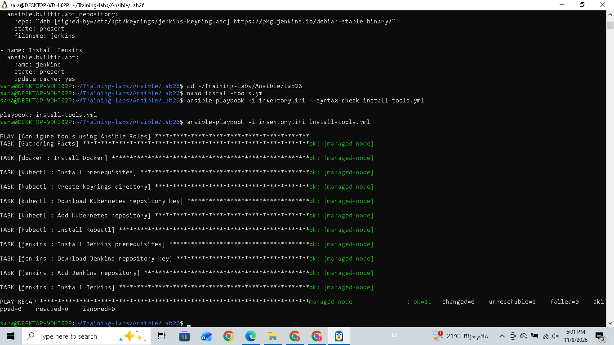

# Lab 26: Structured Configuration Management with Ansible Roles

## Objective

The objective of this lab is to organize Ansible configuration management using separate reusable roles for:

- Docker
- Kubectl
- Jenkins

A main Ansible playbook is created to execute all three roles on the managed node.

## 1. Project Structure

```text
Lab26/
├── inventory.ini
├── install-tools.yml
└── roles/
    ├── docker/
    │   └── tasks/
    │       └── main.yml
    ├── kubectl/
    │   └── tasks/
    │       └── main.yml
    └── jenkins/
        └── tasks/
            └── main.yml
```

Each role contains its own tasks in `tasks/main.yml`.

## 2. Create Ansible Roles

Navigate to the Lab26 directory:

```bash
cd ~/Training-labs/Ansible/Lab26
mkdir -p roles
cd roles
```

Initialize the three roles:

```bash
ansible-galaxy role init docker
ansible-galaxy role init kubectl
ansible-galaxy role init jenkins
```

## 3. Configure Docker Role

File: `roles/docker/tasks/main.yml`

```yaml
---
- name: Install Docker
  ansible.builtin.apt:
    name: docker.io
    state: present
    update_cache: yes
```

This role ensures Docker is installed on the managed node.

## 4. Configure Kubectl Role

File: `roles/kubectl/tasks/main.yml`

```yaml
---
- name: Install prerequisites
  ansible.builtin.apt:
    name:
      - ca-certificates
      - curl
      - gnupg
    state: present
    update_cache: yes

- name: Create keyrings directory
  ansible.builtin.file:
    path: /etc/apt/keyrings
    state: directory
    mode: '0755'

- name: Download Kubernetes repository key
  ansible.builtin.get_url:
    url: https://pkgs.k8s.io/core:/stable:/v1.37/deb/Release.key
    dest: /etc/apt/keyrings/kubernetes-apt-keyring.asc
    mode: '0644'

- name: Add Kubernetes repository
  ansible.builtin.apt_repository:
    repo: "deb [signed-by=/etc/apt/keyrings/kubernetes-apt-keyring.asc] https://pkgs.k8s.io/core:/stable:/v1.37/deb/ /"
    state: present
    filename: kubernetes

- name: Install Kubectl
  ansible.builtin.apt:
    name: kubectl
    state: present
    update_cache: yes
```

This role installs the required prerequisites, configures the Kubernetes repository, and installs Kubectl.

## 5. Configure Jenkins Role

File: `roles/jenkins/tasks/main.yml`

```yaml
---
- name: Install Jenkins prerequisites
  ansible.builtin.apt:
    name:
      - fontconfig
      - openjdk-21-jre
    state: present
    update_cache: yes

- name: Download Jenkins repository key
  ansible.builtin.get_url:
    url: https://pkg.jenkins.io/debian-stable/jenkins.io-2026.key
    dest: /etc/apt/keyrings/jenkins-keyring.asc
    mode: '0644'

- name: Add Jenkins repository
  ansible.builtin.apt_repository:
    repo: "deb [signed-by=/etc/apt/keyrings/jenkins-keyring.asc] https://pkg.jenkins.io/debian-stable binary/"
    state: present
    filename: jenkins

- name: Install Jenkins
  ansible.builtin.apt:
    name: jenkins
    state: present
    update_cache: yes
```

This role installs Java prerequisites, configures the Jenkins repository, and installs Jenkins.

## 6. Create the Main Playbook

File: `install-tools.yml`

```yaml
---
- name: Configure tools using Ansible Roles
  hosts: managed
  become: yes

  roles:
    - docker
    - kubectl
    - jenkins
```

The main playbook calls the three roles in sequence and executes them on the managed node with elevated privileges.

## 7. Validate Playbook Syntax

Command:

```bash
ansible-playbook -i inventory.ini --syntax-check install-tools.yml
```

Output:

```text
playbook: install-tools.yml
```

## 8. Execute the Playbook

Command:

```bash
ansible-playbook -i inventory.ini install-tools.yml
```

Result:

```text
PLAY RECAP
managed-node : ok=11 changed=0 unreachable=0 failed=0
```

All 11 tasks completed successfully with no failures.

## 9. Verify Installed Tools

Command:

```bash
ansible managed -i inventory.ini -b -m shell -a "docker --version && kubectl version --client && dpkg-query -W -f='\${Status} \${Version}\n' jenkins && java -version"
```

Output:

```text
Docker version 29.1.3, build 29.1.3-0ubuntu3~24.04.2
Client Version: v1.37.2
Kustomize Version: v5.8.1
install ok installed 2.580.2
openjdk version "21.0.12.1" 2026-08-18
```

## 10. Screenshot



## Conclusion

Lab26 was completed successfully.

Three separate Ansible roles were created for Docker, Kubectl, and Jenkins. A main playbook was configured to execute all roles on the managed node.

The playbook passed the syntax check, all 11 tasks completed successfully, and the installed tools were verified.
