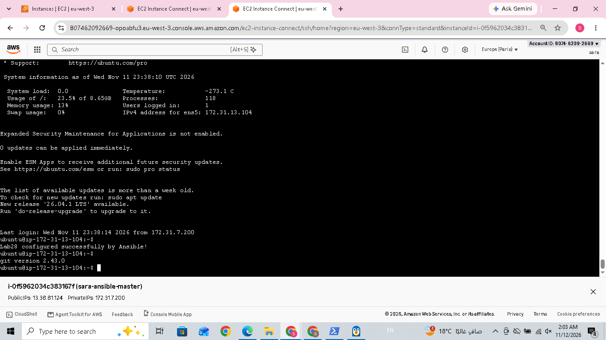
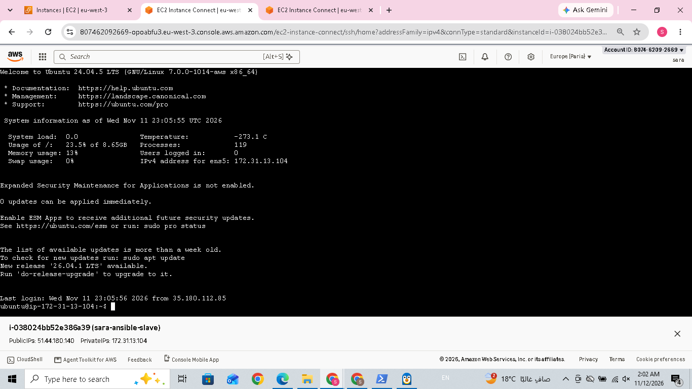

# Lab 28: Automated Host Discovery with Ansible Dynamic Inventory

## 1. Overview

This lab demonstrates how to configure Ansible Dynamic Inventory to automatically discover AWS EC2 instances based on their tags.

Instead of manually maintaining a list of managed hosts, Ansible uses the `amazon.aws.aws_ec2` inventory plugin to retrieve EC2 instances directly from AWS.

The discovered instances are then managed using an Ansible playbook.

## 2. Objectives

- Launch AWS EC2 Master and Managed Node instances.
- Configure SSH connectivity between the Master and Managed Node.
- Tag the Managed Node with `server=ivolve`.
- Configure AWS authentication.
- Install the required Ansible and Python dependencies.
- Configure AWS EC2 Dynamic Inventory.
- Automatically discover running EC2 instances.
- Test connectivity using Ansible Ping.
- Execute an Ansible playbook against discovered hosts.
- Verify the result on the Managed Node.

## 3. Environment

| Component | Configuration |
|---|---|
| Cloud Provider | AWS |
| AWS Region | eu-west-3 |
| Operating System | Ubuntu 24.04 |
| Configuration Management | Ansible |
| Dynamic Inventory Plugin | amazon.aws.aws_ec2 |
| Master Node | AWS EC2 |
| Managed Node | AWS EC2 |

## 4. Architecture

- **Master Node:** Runs Ansible, AWS CLI, Dynamic Inventory, and the playbook.
- **Managed Node:** EC2 instance automatically discovered through its AWS tag.
- **AWS:** Provides EC2 infrastructure and instance metadata.

## 5. Implementation Steps

### Step 1: Launch AWS EC2 Instances

Launch two Ubuntu EC2 instances:

1. Ansible Master.
2. Managed Node (Slave).

Configure SSH access from the Master to the Managed Node.

The Managed Node must have the following tag:

| Key | Value |
|---|---|
| server | ivolve |

The AWS region used in this lab is:

```text
eu-west-3
```

### Step 2: Configure SSH Connectivity

**On the MASTER:**

Generate an SSH key if one does not already exist:

```bash
ssh-keygen -t ed25519
```

Add the public key to the Managed Node's `~/.ssh/authorized_keys`.

Test the SSH connection:

```bash
ssh ubuntu@<MANAGED_NODE_PRIVATE_IP>
```

Expected result: Successful SSH login to the Managed Node.

### Step 3: Install AWS CLI

**On the MASTER:**

Install AWS CLI using the official AWS installation instructions.

Verify the installation:

```bash
aws --version
```

Authenticate using remote login:

```bash
aws login --remote
```

Verify the authenticated identity:

```bash
aws sts get-caller-identity
```

Successful authentication was confirmed using AWS STS.

### Step 4: Verify AWS EC2 Discovery Through AWS CLI

**On the MASTER:**

Run:

```bash
aws ec2 describe-instances \
  --region eu-west-3 \
  --filters "Name=tag:server,Values=ivolve" "Name=instance-state-name,Values=running" \
  --query "Reservations[].Instances[].PrivateIpAddress" \
  --output table
```

Actual output:

```text
-----------------------
|  DescribeInstances  |
+---------------------+
|  172.31.13.104      |
+---------------------+
```

This confirms that AWS can find the running EC2 instance tagged `server=ivolve`.

### Step 5: Create a Python Virtual Environment

**On the MASTER:**

Install Python virtual environment support:

```bash
sudo apt install python3-venv -y
```

Create the project directory:

```bash
mkdir -p ~/lab28
cd ~/lab28
```

Create the virtual environment:

```bash
python3 -m venv ~/lab28/venv
```

Activate it:

```bash
source ~/lab28/venv/bin/activate
```

The terminal prompt should show:

```text
(venv) ubuntu@ip-172-31-7-200:~/lab28$
```

### Step 6: Install Python Dependencies

**On the MASTER, inside the virtual environment:**

Install Boto3 and AWS CRT support:

```bash
pip install --upgrade "boto3[crt]"
```

Install Ansible Core:

```bash
pip install ansible-core
```

Install the AWS collection:

```bash
ansible-galaxy collection install amazon.aws
```

Verify that the AWS EC2 inventory plugin is available:

```bash
ansible-doc -t inventory amazon.aws.aws_ec2
```

Expected result: Documentation for the `amazon.aws.aws_ec2` inventory plugin is displayed.

### Step 7: Configure AWS EC2 Dynamic Inventory

**On the MASTER:**

Create the inventory configuration file:

```bash
nano aws_ec2.yml
```

Add:

```yaml
plugin: amazon.aws.aws_ec2

regions:
  - eu-west-3

filters:
  tag:server: ivolve
  instance-state-name: running

hostnames:
  - private-ip-address
```

Save and exit:

- `Ctrl + O`
- `Enter`
- `Ctrl + X`

Explanation:

- `plugin`: Uses the AWS EC2 inventory plugin.
- `regions`: Searches in `eu-west-3`.
- `tag:server`: Discovers instances tagged `server=ivolve`.
- `instance-state-name`: Includes only running instances.
- `hostnames`: Uses private IP addresses as Ansible hostnames.

### Step 8: Verify Dynamic Inventory

**On the MASTER:**

Run:

```bash
ansible-inventory -i aws_ec2.yml --graph
```

Actual output:

```text
@all:
  |--@ungrouped:
  |--@aws_ec2:
  |  |--172.31.13.104
```

This confirms that Ansible successfully discovered the Managed Node automatically.

### Step 9: Test Ansible Connectivity

**On the MASTER:**

Run:

```bash
ansible -i aws_ec2.yml aws_ec2 -m ping
```

Actual output:

```text
172.31.13.104 | SUCCESS => {
    "ansible_facts": {
        "discovered_interpreter_python": "/usr/bin/python3.12"
    },
    "changed": false,
    "ping": "pong"
}
```

The `pong` response confirms successful Ansible connectivity.

### Step 10: Create the Ansible Playbook

**On the MASTER:**

Create the playbook:

```bash
nano lab28.yml
```

Add:

```yaml
---
- name: Configure Slave EC2
  hosts: aws_ec2
  become: true

  tasks:
    - name: Create verification file
      ansible.builtin.copy:
        dest: /home/ubuntu/lab28.txt
        content: "Lab28 configured successfully by Ansible!\n"
        owner: ubuntu
        group: ubuntu
        mode: "0644"
```

Save and exit:

- `Ctrl + O`
- `Enter`
- `Ctrl + X`

Explanation:

- `hosts: aws_ec2`: Targets hosts discovered through Dynamic Inventory.
- `become: true`: Runs tasks with elevated privileges.
- `copy`: Creates the verification file.
- `dest`: Specifies the file location.
- `content`: Defines the file content.
- `owner` and `group`: Set file ownership.
- `mode`: Sets file permissions.

### Step 11: Execute the Playbook

**On the MASTER:**

Run:

```bash
ansible-playbook -i aws_ec2.yml lab28.yml
```

Actual output:

```text
PLAY [Configure Slave EC2] ****************************************

TASK [Gathering Facts] ********************************************
ok: [172.31.13.104]

TASK [Create verification file] **********************************
ok: [172.31.13.104]

PLAY RECAP ********************************************************
172.31.13.104 : ok=2 changed=0 unreachable=0 failed=0
```

The playbook completed successfully.

`changed=0` means the file already existed with the requested content and permissions from the earlier static-inventory test. Ansible confirmed that the desired state was already present.

### Step 12: Verify the Result on the Managed Node

**On the SLAVE:**

Connect from the Master:

```bash
ssh ubuntu@172.31.13.104
```

Check the verification file:

```bash
cat /home/ubuntu/lab28.txt
```

Actual output:

```text
Lab28 configured successfully by Ansible!
```

This confirms that the playbook successfully configured the Managed Node.

## 6. Project Files

```text
Lab28/
├── aws_ec2.yml
├── inventory.ini
├── lab28.yml
├── README.md
└── screenshots/
```

### File Descriptions

- `aws_ec2.yml`: AWS EC2 Dynamic Inventory configuration.
- `inventory.ini`: Static inventory used during initial connectivity testing.
- `lab28.yml`: Ansible playbook used to configure the Managed Node.
- `README.md`: Lab documentation.
- `screenshots/`: Evidence of the lab execution.

## 7. Screenshots

The following screenshots provide evidence of the successful implementation:

1. AWS EC2 instances and the `server=ivolve` tag.
2. AWS CLI authentication and EC2 discovery.
3. Dynamic Inventory graph showing the discovered instance.
4. Successful Ansible Ping (`pong`).
5. Successful Ansible playbook execution.
6. Final verification file on the Managed Node.

Screenshots are stored in the `screenshots/` directory.

## 8. Final Result

**Lab 28 was completed successfully.**

- AWS EC2 instances were configured.
- SSH connectivity was established.
- AWS authentication was configured.
- The AWS EC2 Dynamic Inventory plugin was installed.
- The tagged running instance was automatically discovered.
- Ansible connectivity was verified successfully.
- The playbook executed without failures.
- The verification file was confirmed on the Managed Node.

Final verification:

```text
Lab28 configured successfully by Ansible!
```

**Status: Completed Successfully.**


## Screenshots

### MASTER Node


### SLAVE Node

