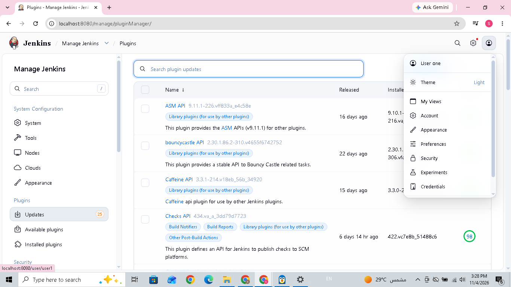
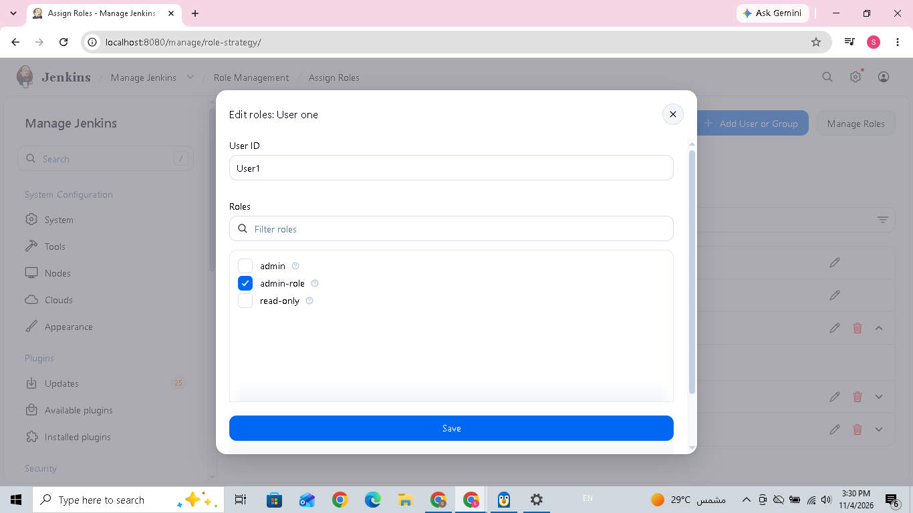
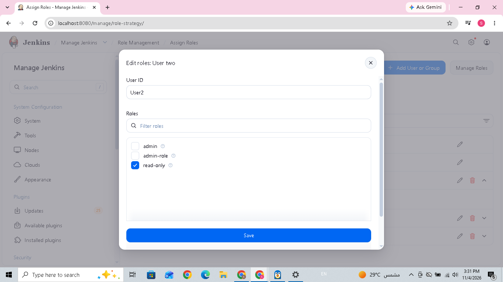
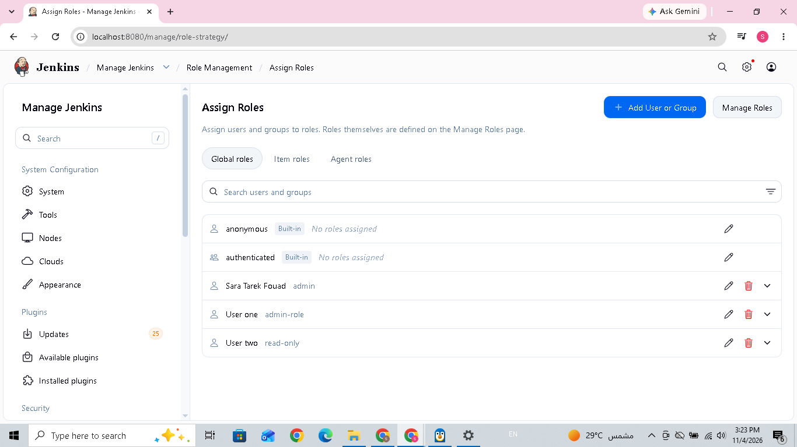
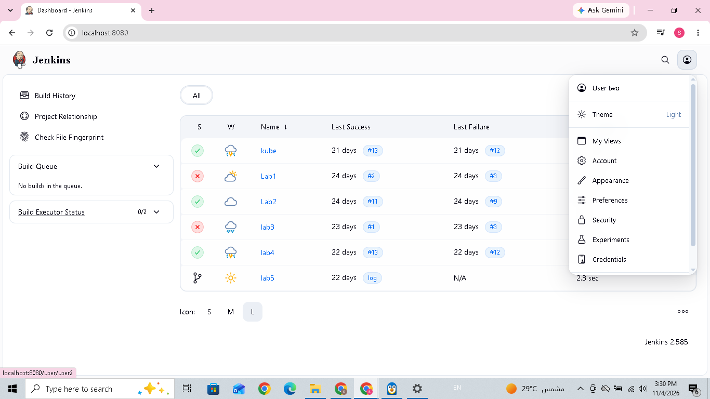

# Lab 20: Role-Based Authorization in Jenkins

## Lab Objective

The objective of this lab is to configure Role-Based Authorization in Jenkins to control user access according to assigned roles and permissions.

## Step 1: Start Jenkins

Start the existing Jenkins container:

```bash
docker start jenkins-container
```

Open Jenkins in the browser:

```text
http://localhost:8080
```

**Expected Result:** The Jenkins dashboard becomes accessible.

## Step 2: Install Required Plugins

Navigate to:

**Manage Jenkins → Plugins → Available plugins**

Search for and install:

1. Authentication and Authorization Commons
2. Role-based Authorization Strategy

Wait until the installation process finishes successfully, then restart Jenkins if required.

**Result:** Both plugins were installed successfully, and Jenkins loaded the extensions after restarting.



## Step 3: Enable Role-Based Authorization

Navigate to:

**Manage Jenkins → Security → Authorization**

Select **Role-Based Strategy**, then save the configuration.

**Explanation:** Role-Based Strategy allows Jenkins administrators to assign permissions to roles instead of granting permissions individually to every user.

## Step 4: Create Global Roles

Navigate to:

**Manage Jenkins → Manage and Assign Roles → Manage Roles**

Create the following Global Roles.

### 4.1 admin-role

Assign this permission:

- Overall → Administer

This permission grants full administrative control over Jenkins.

### 4.2 read-only

Assign these permissions:

- Overall → Read
- Job → Read
- View → Read

These permissions allow the user to view Jenkins and its jobs without administrative privileges.

**Result:** Two global roles were created with different permission levels.

## Step 5: Create Jenkins Users

Navigate to:

**Manage Jenkins → Users → Create User**

Create the following users:

### User 1

- Username: `User1`
- Full Name: `User One`

### User 2

- Username: `User2`
- Full Name: `User Two`

**Explanation:** The username is the unique user ID used by Jenkins for authentication and role assignment. The full name is the display name.

## Step 6: Assign Roles to Users

Navigate to:

**Manage Jenkins → Manage and Assign Roles → Assign Roles**

Under **Global roles**, assign:

| User | Assigned role |
|---|---|
| User1 | admin-role |
| User2 | read-only |

Keep the original `admin` account unchanged.

### 6.1 Assign admin-role to User1

Select `User1` and assign the `admin-role`.



### 6.2 Assign read-only to User2

Select `User2` and assign the `read-only` role.



### 6.3 Role Assignment Overview

The Assign Roles page displays the users and their assigned global roles.



**Expected Result:**

- User1 is assigned `admin-role`.
- User2 is assigned `read-only`.
- The original admin account is preserved.

## Step 7: Verify User Access

Log in to Jenkins using the created users and verify their access.

### 7.1 User2 — Read-Only Access

Log in using `User2`.

The Jenkins dashboard is accessible, and the user can view the available jobs and build information.



### 7.2 User1 — Administrator Access

User1 is assigned `admin-role`, which includes the `Overall → Administer` permission. This role provides administrative access to Jenkins.

## Conclusion

Successfully configured Role-Based Authorization in Jenkins.

The lab demonstrated how to:

- Install the required authorization plugins.
- Enable Role-Based Strategy.
- Create global roles with different permissions.
- Create Jenkins users.
- Assign roles to users.
- Verify user access through the Jenkins dashboard.

Role-Based Authorization helps manage Jenkins access by granting users the permissions associated with their assigned roles.
