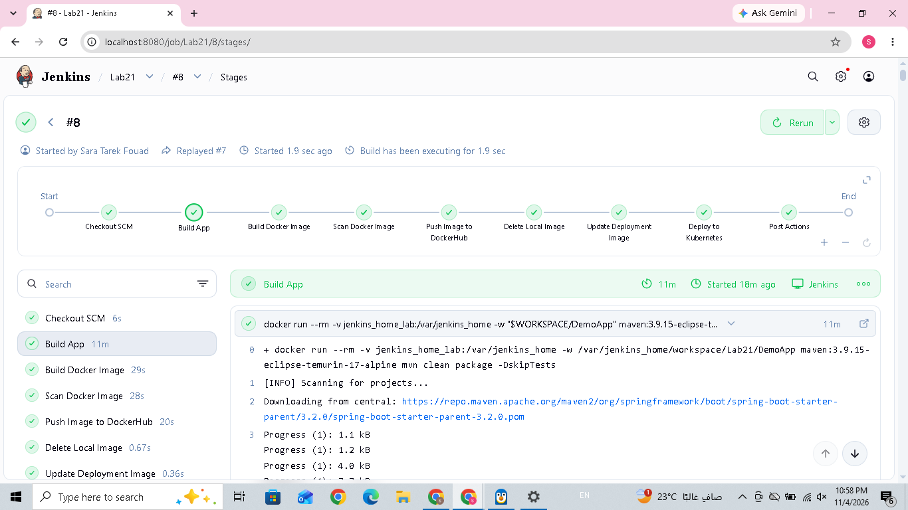
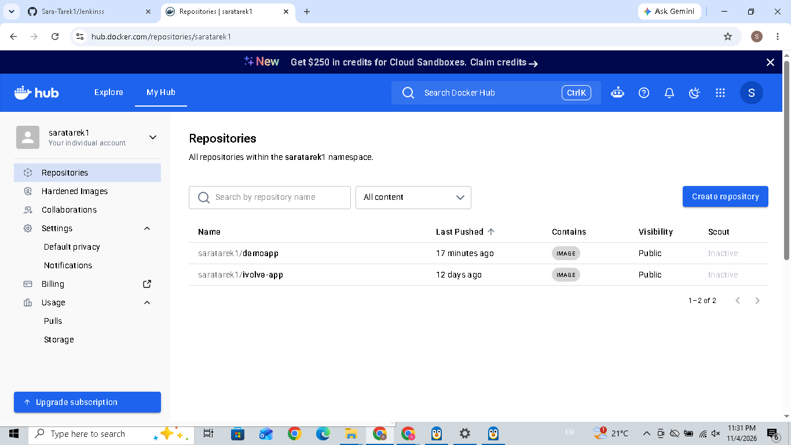

# Lab 21: Jenkins CI/CD Pipeline for Kubernetes Deployment

## 1. Overview

The goal of this lab is to create a Jenkins CI/CD pipeline that automates the process of building a Spring Boot application, creating and scanning a Docker image, pushing the image to DockerHub, and deploying the application to a Kubernetes cluster.

The pipeline also includes post-build actions to handle successful and failed executions.

## 2. Source Code

The application source code and Dockerfile were cloned from:

[DemoApp GitHub Repository](https://github.com/Ibrahim-Adel15/DemoApp.git)

The application is a Spring Boot application built using Maven.

## 3. Tools and Technologies

- Jenkins – CI/CD automation
- Git and GitHub – Source code management
- Maven – Application build
- Docker – Containerization
- DockerHub – Image registry
- Trivy – Container image vulnerability scanning
- Kubernetes – Container orchestration
- Minikube – Local Kubernetes cluster
- kubectl – Kubernetes management

## 4. Project Structure

```text
Lab21/
├── DemoApp/
│   ├── Dockerfile
│   ├── pom.xml
│   └── src/
├── Jenkinsfile
├── deployment.yaml
├── screenshots/
│   ├── jenkins-pipeline.png
│   └── dockerhub-image.png
└── README.md
```

## 5. Jenkins Pipeline Configuration

A Declarative Jenkins Pipeline was created in the `Jenkinsfile`.

The pipeline uses the following environment variables:

- `DOCKER_IMAGE`: saratarek1/demoapp
- `IMAGE_TAG`: Jenkins BUILD_NUMBER

This allows every pipeline execution to produce an image with a unique build-number tag.

### Pipeline Stages

#### Stage 1: Build App

- Builds the Spring Boot application using Maven.
- Generates the application JAR file inside the `target/` directory.

**Result:** The application build stage completed successfully.

#### Stage 2: Build Docker Image

- Uses the application's Dockerfile to build the Docker image.
- Tags the image using the Jenkins build number.

**Image format:**

```text
saratarek1/demoapp:<BUILD_NUMBER>
```

**Result:** Docker image created successfully.

#### Stage 3: Scan Docker Image

- Uses Trivy to scan the generated Docker image.
- Checks the image for known security vulnerabilities.

**Result:** The Trivy scanning stage was executed as part of the pipeline.

#### Stage 4: Push Image to DockerHub

- Authenticates with DockerHub using Jenkins credentials.
- Pushes the generated image to the DockerHub repository.

**DockerHub Repository:**

[https://hub.docker.com/r/saratarek1/demoapp](https://hub.docker.com/r/saratarek1/demoapp)

**Result:** The image was pushed to DockerHub successfully.

#### Stage 5: Delete Local Image

- Removes the local Docker image after pushing it to DockerHub.
- Helps save local disk space.

**Result:** The pipeline includes the local image cleanup stage.

#### Stage 6: Update Deployment Image

- Updates the image reference in `deployment.yaml`.
- Uses the current Jenkins build number as the image tag.

**Image format in deployment.yaml:**

```yaml
image: saratarek1/demoapp:<BUILD_NUMBER>
```

**Verification command:**

```bash
grep demoapp deployment.yaml
```

**Result:** The deployment image reference was updated with the Jenkins build tag.

#### Stage 7: Deploy to Kubernetes

The pipeline deploys the application using:

```bash
kubectl apply -f deployment.yaml
kubectl rollout status deployment/ivolveapp -n ivolve
```

**Result:** The deployment was applied to the `ivolve` namespace, and Jenkins waits for the rollout to complete.

## 6. Kubernetes Deployment Configuration

The application Deployment is configured with:

- Namespace: `ivolve`
- Replicas: `2`
- Node selector: `project: ivolve`
- Toleration: `workload=ivolveApp:NoSchedule`
- ConfigMap: `ivolvecm`
- Secret: `ivolvesecret`
- Persistent Volume Claim for application logs
- MySQL init container

### Rolling Update Strategy

The Deployment uses the following strategy:

```yaml
strategy:
  type: RollingUpdate
  rollingUpdate:
    maxSurge: 0
    maxUnavailable: 1
```

This configuration prevents Kubernetes from creating an additional Pod during the rolling update, helping the Deployment work within the namespace Pod ResourceQuota.

## 7. Kubernetes Verification

The following commands were used to inspect the Kubernetes resources:

**Check Deployment:**

```bash
kubectl get deployment ivolveapp -n ivolve
```

**Check Pods:**

```bash
kubectl get pods -n ivolve -o wide
```

**Check Services:**

```bash
kubectl get services -n ivolve
```

**Check Service Endpoints:**

```bash
kubectl get endpoints ivolvaappsvc -n ivolve
```

The application Service was configured with:

- Service port: `3000`
- Target port: `8080`

The application Pods were listening on port `8080`.

## 8. Application Testing

The application was tested through the Kubernetes Service using port forwarding.

**Start port forwarding:**

```bash
kubectl port-forward service/ivolvaappsvc 8081:3000 -n ivolve
```

Port `8081` was used on the host because port `8080` was already occupied by Jenkins.

**Test the application from another terminal:**

```bash
curl -i http://localhost:8081/
```

**Actual application response:**

```text
HTTP/1.1 200
Content-Type: text/plain;charset=UTF-8
Content-Length: 34

Hello from Dockerized Spring Boot!
```

The HTTP 200 response confirms that the application was successfully accessed through the Kubernetes Service.

## 9. Jenkins Post Actions

The pipeline includes three post-build actions:

```groovy
post {
    always {
        echo 'Pipeline execution finished.'
    }

    success {
        echo 'Pipeline completed successfully!'
    }

    failure {
        echo 'Pipeline failed. Check the logs.'
    }
}
```

- **always:** Executes regardless of the pipeline result.
- **success:** Executes when the pipeline completes successfully.
- **failure:** Executes when the pipeline fails.

## 10. Screenshots

### Jenkins Pipeline Execution

The screenshot below shows the Jenkins pipeline execution and its successful completion.



### DockerHub Image

The screenshot below shows the Docker image uploaded to the DockerHub repository.



## 11. Final Result

Successfully implemented a Jenkins CI/CD pipeline that automates all seven required stages:

1. Build the application.
2. Build the Docker image.
3. Scan the Docker image using Trivy.
4. Push the image to DockerHub.
5. Delete the local Docker image.
6. Update the Kubernetes deployment image.
7. Deploy the application to the Kubernetes cluster.

The pipeline also includes `always`, `success`, and `failure` post-build actions.

The Spring Boot application was successfully deployed and tested through the Kubernetes Service, returning HTTP 200.
