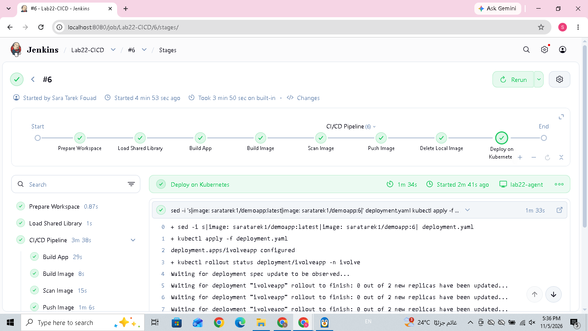

# Lab 22: Jenkins CI/CD Pipeline with Shared Library, Docker, Trivy, and Kubernetes

## 1. Lab Objective

The objective of this lab is to build an automated CI/CD pipeline using Jenkins.

The pipeline automates:
- Preparing the Jenkins Agent workspace.
- Loading a Jenkins Shared Library.
- Building and testing a Spring Boot application using Maven.
- Building a Docker image.
- Scanning the Docker image using Trivy.
- Pushing the image to Docker Hub.
- Deploying the application to Kubernetes.
- Verifying the Kubernetes rollout.

## 2. Tools and Technologies

- Jenkins
- Jenkins Pipeline
- Jenkins Shared Library
- Jenkins Agent
- Java 17
- Maven
- Docker
- Docker Hub
- Trivy
- Kubernetes
- kubectl
- YAML
- Git

## 3. Project Structure

```text
Lab22/
├── .gitignore
├── Jenkinsfile
├── README.md
├── deployment.yaml
├── DemoApp/
│   ├── Dockerfile
│   ├── pom.xml
│   └── src/
├── agent/
│   └── Dockerfile
├── shared-library/
│   └── vars/
│       ├── buildApp.groovy
│       ├── buildImage.groovy
│       └── deployOnK8s.groovy
└── screenshots/
    └── jenkins-build-success.png
```

## 4. Jenkins Agent Configuration

A custom Jenkins inbound agent was prepared using `agent/Dockerfile`.

The agent includes:
- Java 21
- Maven
- Docker CLI
- Node.js and npm
- kubectl
- Trivy

The agent is connected to the Jenkins controller using the label `lab22-agent`.

## 5. Jenkins Credentials

A Docker Hub credential was configured in Jenkins.

- Credentials ID: `dockerhub-credentials`
- Type: Username with password

The pipeline uses Jenkins `withCredentials` to authenticate securely with Docker Hub using `--password-stdin`.

## 6. Jenkins Shared Library

The Shared Library contains reusable pipeline functions.

### 6.1 buildApp.groovy

This function enters the `DemoApp` directory and executes:

```bash
mvn clean test package
```

It cleans previous build files, runs tests, and packages the Spring Boot application into a JAR file.

### 6.2 buildImage.groovy

This function performs four stages:

1. **Build Image:** Builds the Docker image using the Dockerfile inside `DemoApp`.
2. **Scan Image:** Scans the image using Trivy.
3. **Push Image:** Logs in to Docker Hub and pushes the image.
4. **Delete Local Image:** Removes the local image after pushing it.

Docker image repository:

`saratarek1/demoapp`

The image tag is generated from the Jenkins build number.

### 6.3 deployOnK8s.groovy

This function:
- Updates the image tag in `deployment.yaml`.
- Applies the Kubernetes manifest.
- Waits for the Deployment rollout to finish.

Commands:

```bash
kubectl apply -f deployment.yaml
kubectl rollout status deployment/ivolveapp -n ivolve
```

## 7. Jenkins Pipeline Flow

The successful pipeline execution followed these stages:

1. **Prepare Workspace:** Extracts the application source archive into the Jenkins Agent workspace.
2. **Load Shared Library:** Loads the `Lab22Shared` library.
3. **Build App:** Runs Maven clean, tests, and packages the application.
4. **Build Image:** Builds the Docker image.
5. **Scan Image:** Scans the image using Trivy.
6. **Push Image:** Pushes the image to Docker Hub using Jenkins credentials.
7. **Delete Local Image:** Removes the local image after pushing.
8. **Deploy on Kubernetes:** Updates the Kubernetes Deployment and waits for a successful rollout.

## 8. Kubernetes Deployment

The application is deployed in the `ivolve` namespace.

Deployment configuration:
- Deployment name: `ivolveapp`
- Replicas: 2
- Update strategy: RollingUpdate
- Container port: 8080
- Node selector: `project=ivolve`
- Toleration: `workload=ivolveApp:NoSchedule`

The Deployment also uses:
- An init container to initialize the MySQL database.
- ConfigMap `ivolvecm` for database configuration.
- Secret `ivolvesecret` for sensitive database values.
- PVC `ivolvepvc` to persist application logs.

## 9. Pipeline Execution Results

The successful Jenkins execution used build number `6`.

Docker image:

`saratarek1/demoapp:6`

### Maven Build

The Maven build completed successfully.

Test results:
- Tests run: 1
- Failures: 0
- Errors: 0
- Skipped: 0

### Trivy Scan

The scan completed and reported:

- Total vulnerabilities: 93
- Critical: 9
- High: 37
- Medium: 33
- Low: 14

The scan completed successfully, but the report identified vulnerabilities that should be reviewed and addressed.

### Docker Hub Push

The Docker image was successfully pushed to:

`docker.io/saratarek1/demoapp:6`

### Kubernetes Rollout

The Deployment was successfully updated.

Jenkins reported:

`deployment "ivolveapp" successfully rolled out`

### Jenkins Build Screenshot



## 10. Kubernetes Verification

The application pods were checked using:

```bash
docker exec lab22-agent kubectl get pods -n ivolve -o wide
```

The two application pods were running successfully:

- `ivolveapp-549584494c-q2fgf`
- `ivolveapp-549584494c-z6h96`

Both pods were Ready (1/1) with zero restarts.

The application Service endpoints were also verified.

## 11. Application Testing

The application was tested through Kubernetes port forwarding.

Start port forwarding:

```bash
docker exec -d lab22-agent kubectl port-forward \
  -n ivolve svc/ivolvaappsvc 18080:3000 \
  --address 0.0.0.0
```

Test the application:

```bash
docker exec lab22-agent curl -i http://localhost:18080
```

Successful response:

```text
HTTP/1.1 200
Content-Type: text/plain;charset=UTF-8

Hello from Dockerized Spring Boot!
```

## 12. Conclusion

Successfully implemented a Jenkins CI/CD pipeline integrating a Jenkins Shared Library, Maven, Docker, Trivy, Docker Hub, and Kubernetes.

The pipeline automates application building, testing, image creation, vulnerability scanning, image publishing, and Kubernetes deployment.

The application was deployed with two replicas, and its availability was verified through an HTTP 200 response.

